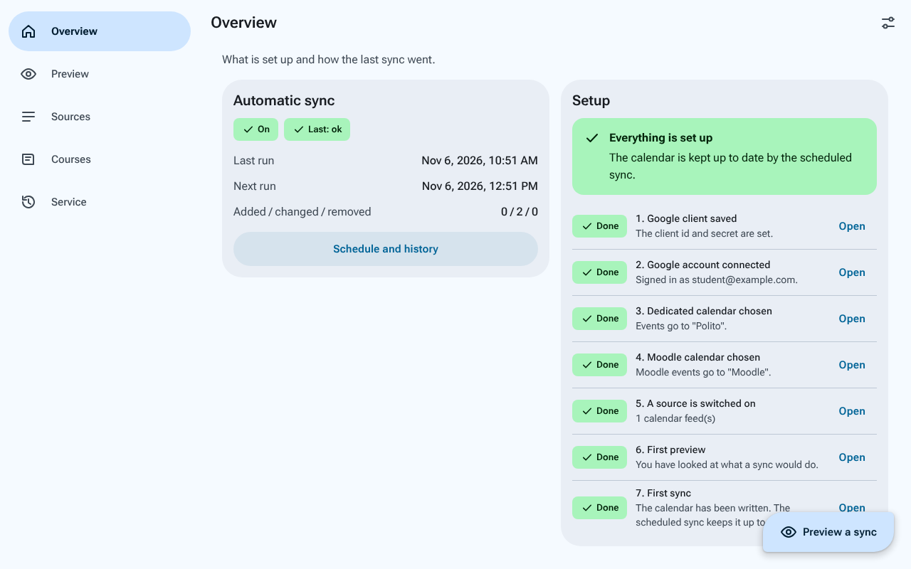
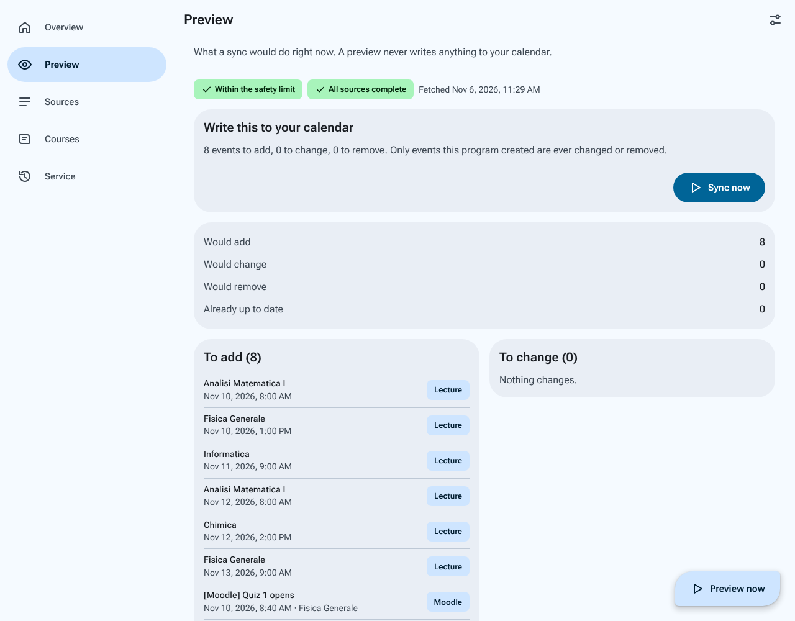
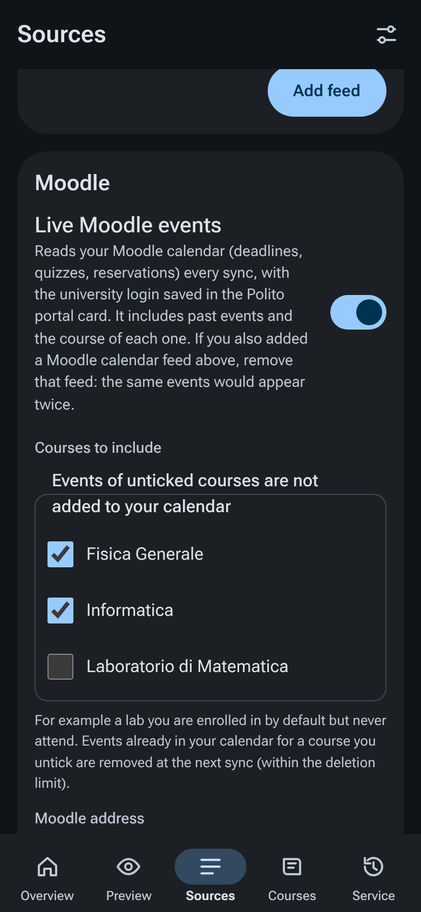
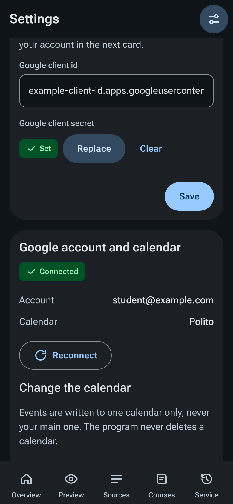
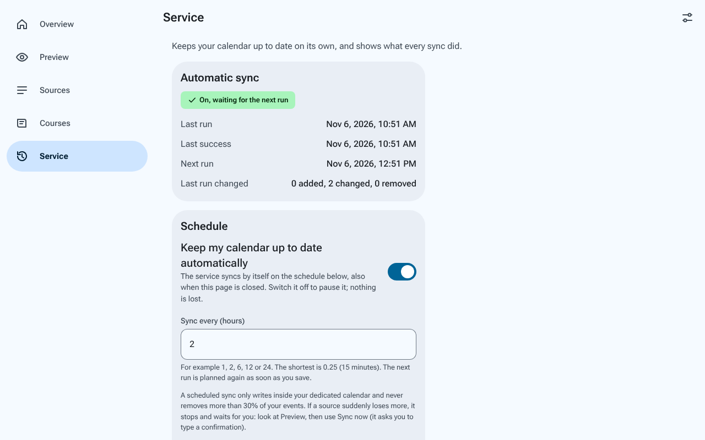
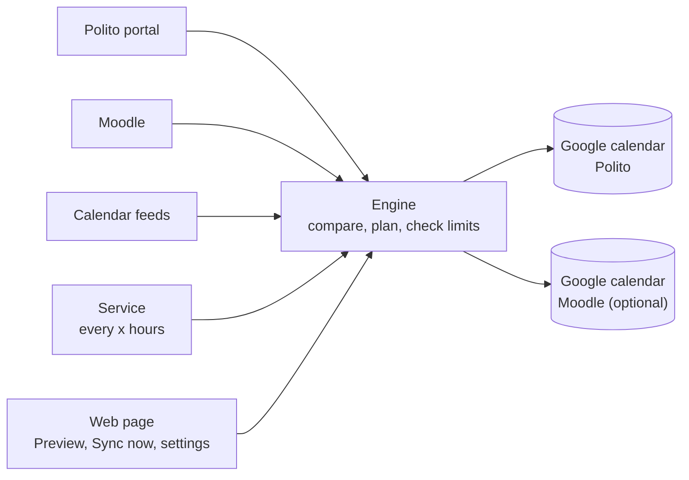

<h1 align="center">polito-cal-sync</h1>

<p align="center">
  <strong>Your Politecnico di Torino schedule, exams, deadlines and Moodle events, kept in Google Calendar automatically.</strong><br/>
  Self-hosted, local-first, one Docker container and a web page. No cloud service in the middle.
</p>

<p align="center">
  <a href="https://github.com/LucaCraft89/polito-cal-sync/actions/workflows/ci.yml"></a>
  
  
  
</p>

> **Unofficial.** Not affiliated with or endorsed by Politecnico di Torino. It is meant for one student's own schedule, on their own machine. Read [what it does with your university login](#your-data-and-your-logins) before you switch on the portal or Moodle sources.

<p align="center">
  
  
</p>

## What it does

- **Reads** your lectures, booked exams, exam calls, bookings and deadlines from the Polito student portal, your course calendar feeds (ICS), and your **Moodle** calendar.
- **Writes** them into a Google calendar **of its own**, never your main one. It only ever touches events it created itself.
- **Keeps them up to date** on a schedule you choose (every few hours, or whatever you like), in the background, from a Docker container that restarts by itself.
- **Shows you what it will do first.** A _Preview_ reads everything and writes nothing. _Sync now_ writes only what you looked at.
- **Stays out of your way:** leave a Moodle course out (that lab you are enrolled in but never attend), pick your squad per course, and keep Moodle in a second calendar so you can hide it on its own.

Everything is done from one local web page, designed for phones as much as laptops. No `.env` editing is needed.

<p align="center">
  
  
  
</p>

## Quick start (Docker)

You need Docker and about ten minutes. The Google step is done once.

```bash
git clone https://github.com/LucaCraft89/polito-cal-sync.git
cd polito-cal-sync
docker compose up -d
```

Then open **<http://localhost:8787>**. By default only this machine can reach it; to open it to your network see [running it on a server](#running-it-on-a-server).

1. **Choose a passphrase.** It protects the page, because the page can change your calendar and holds your university login.
2. **Create a Google client** (once, [about ten minutes](docs/SETUP.md#2-create-the-google-client-about-10-minutes-once)): in the Google Cloud console enable the Calendar API, create an OAuth client of type _Desktop app_ and **publish the app** ("In production"; in "Testing" mode Google ends the login after 7 days). Paste the client id and secret in **Settings**.
3. **Connect Google** and create the dedicated calendar, in **Settings → Google account and calendar**.
4. **Add your sources** in **Sources**, each with a **Test** button: a calendar feed link, the Polito portal, live Moodle.
5. **Preview**, read it, then **Sync now**.

The **Overview** page lists these steps in order and always shows the next one. After the first sync the container keeps the calendar current by itself.

<details>
<summary>Without Docker</summary>

Needs Node.js 22 or newer and [pnpm](https://pnpm.io).

```bash
pnpm install
UI_ENABLED=true pnpm serve      # then open http://localhost:8787
```

Data (logins, settings, history) lives in `./data`, private to your user. Run `pnpm run doctor` any time to check the setup (`pnpm doctor` without `run` is a pnpm built-in and does nothing useful).

</details>

### Running it on a server

For a home server or a Raspberry Pi that other devices should reach, copy the example settings first. It switches the page on and publishes it on every interface:

```bash
cp .env.example .env        # UI_ENABLED=true and BIND_ADDRESS=0.0.0.0 are already set
docker compose up -d
```

- Open `http://<server IP>:8787` from your phone or laptop (an IP address needs no extra setting; a DNS name must be added to `UI_ALLOWED_HOSTS`).
- **First run:** choosing the passphrase and **connecting Google** must be done on the server itself (`http://localhost:8787`; over SSH: `ssh -L 8787:localhost:8787 -L 8789:localhost:8789 server`), because Google sends the browser back to `127.0.0.1`. After that, any device on your network can use the page.
- The page has a passphrase, login throttling and session protection, but **no HTTPS**. Use a trusted network or a VPN, or put your own TLS reverse proxy in front (`UI_HTTPS=true`). To keep it to the server only, set `BIND_ADDRESS=127.0.0.1`.
- Only the infrastructure settings are active in `.env.example`; everything else is commented out so the web page stays in control (a variable that is set in `.env` wins over the page and locks its field).

## Using it

| You want to                     | Where                                                          | Notes                                                                                                                                   |
| ------------------------------- | -------------------------------------------------------------- | --------------------------------------------------------------------------------------------------------------------------------------- |
| See what a sync would do        | **Preview**                                                    | Never writes. Shows adds, changes, removals, incomplete sources and problems in plain words.                                            |
| Write to the calendar           | **Preview → Sync now**                                         | Needs a fresh preview you looked at. If it would remove more than your limit (30 %), you must type `remove N` first.                    |
| Let it run by itself            | **Service**                                                    | On/off switch and "sync every _x_ hours". Applies at once. Shows the last run, the next run and every past run.                         |
| Add the Polito portal           | **Sources → Polito portal**                                    | Lectures, booked exams, bookings, deadlines. **Test login** checks it. Pick your squad per course with checkboxes after the first read. |
| Add Moodle                      | **Sources → Moodle**                                           | _Live Moodle events_ reads your whole calendar with the same university login. No link to copy, includes the past and the course.       |
| Leave a Moodle course out       | **Sources → Moodle → Courses to include**                      | Untick it. Its events are not added, and are removed at the next sync (within the deletion limit).                                      |
| Keep Moodle in its own calendar | **Settings → Keep Moodle events in their own calendar**        | Events keep their `[Moodle]` label. Existing ones move over safely (copy first, delete after).                                          |
| Add a course calendar feed      | **Sources → Calendar feeds**                                   | Any `.ics` link, including Moodle's export (use `preset_time=custom` at the end of the link for about a year ahead).                    |
| Check everything                | `docker compose exec polito-cal-sync node dist/main.js doctor` | Data folder, clock, Google, every source, last sync. Each problem comes with what happened, why and what to do.                         |

Pages update by themselves while you watch (no refresh needed).

## How it works



Each run fetches every source, compares the result with the events this program wrote earlier (they carry a hidden marker), and applies the difference. Sources are read one request at a time, with an honest `User-Agent` and low traffic.

### Safety

| Rule                     | What it means                                                                                                                                                        |
| ------------------------ | -------------------------------------------------------------------------------------------------------------------------------------------------------------------- |
| Own calendar, own events | It writes only into the calendar you chose (never your main one) and only changes events carrying its marker. It never deletes a calendar.                           |
| Fail closed              | If a source is incomplete or unreadable (outage, expired login, unexpected answer), **nothing is deleted** for it. The other sources still sync.                     |
| Deletion limit           | A run that would remove more than 30 % of the events it manages is refused. Beyond it, only Sync now with a typed confirmation can proceed.                          |
| Preview first            | Sync now works only on a preview less than 30 minutes old, made with the current settings, that you were looking at. It cannot remove more than that preview showed. |
| No repeated wrong logins | If the university refuses your password, no new attempt is made until you change it, so an hourly retry never gets your account locked.                              |
| One sync at a time       | A lock (refreshed while a sync works, dead 90 seconds after a stopped one) keeps the scheduled run, the button and the command line from writing together.           |
| Rate limits              | Everything that contacts the university or Google is limited (a test or sync at most once per 15 minutes per login or feed).                                         |

## Configuration

Everything can be set in the web page. The same settings exist as environment variables (in a `.env` file or in Docker); **a variable that is set wins over the page and shows as locked there**. The full annotated list is in [`.env.example`](.env.example).

| Variable                                                             | Default                      | Purpose                                                          |
| -------------------------------------------------------------------- | ---------------------------- | ---------------------------------------------------------------- |
| `TZ`                                                                 | `Europe/Rome`                | Time zone for events without one.                                |
| `SYNC_AUTO`, `SYNC_INTERVAL_MINUTES`                                 | `true`, `60`                 | Automatic sync on/off and the interval (15 to 1440 minutes).     |
| `DELETE_THRESHOLD`                                                   | `0.3`                        | Largest share of events one run may remove without confirmation. |
| `GOOGLE_CLIENT_ID`, `GOOGLE_CLIENT_SECRET`                           |                              | Your Google OAuth client.                                        |
| `SOURCE_POLITO_ICS_URLS`                                             |                              | Calendar feed links, comma separated.                            |
| `SOURCE_POLITO_PORTAL_ENABLED`, `POLITO_USERNAME`, `POLITO_PASSWORD` | `false`                      | The Polito portal source and its login.                          |
| `POLITO_EXAM_CALLS`, `POLITO_SQUADS`                                 | `booked`                     | Booked exams only (or `all`); your squad per course.             |
| `SOURCE_MOODLE_ENABLED`, `MOODLE_EXCLUDED_COURSES`                   | `false`                      | Live Moodle, and the Moodle course ids to leave out.             |
| `CALENDAR_SPLIT_MOODLE`, `GOOGLE_MOODLE_CALENDAR_ID`                 | `false`                      | Keep Moodle events in a second calendar.                         |
| `UI_ENABLED`, `UI_ALLOWED_HOSTS`, `UI_HTTPS`                         | on in Docker                 | The web page, extra host names, a TLS proxy in front.            |
| `DATA_DIR`                                                           | `./data` (`/data` in Docker) | Where logins, settings and history live.                         |

### Command line

```bash
pnpm serve                       # the service: scheduled sync + web page
pnpm sync --dry-run              # what a sync would do (writes nothing)
pnpm sync                        # one sync now
pnpm auth google                 # connect Google from the terminal instead of the page
pnpm run doctor [--local]        # check the setup; --local contacts nobody
pnpm reset-ui-passphrase         # forgot the page passphrase (needs access to the data folder)
```

## Your data and your logins

- **Where things live.** Logins, tokens, settings and history are files in the data folder (a Docker volume), readable only by your user. They are **not encrypted at rest**: protect the disk or volume. Nothing is sent anywhere except to Google, the university and Moodle.
- **The web page** listens on `127.0.0.1` only, asks for a passphrase, uses server-side sessions, CSRF protection and a strict content-security policy, loads nothing from other sites, and never sends a stored password or secret back to the browser. To use it from another device, put your own VPN or TLS reverse proxy in front (`UI_ALLOWED_HOSTS`, `UI_HTTPS`).
- **Polito portal and Moodle** use your university username and password, the way a browser does (university single sign-on). That is not an advertised interface: it can break when the university changes the login, and a new "device" can in principle be asked for a second factor (then the source stops safely and says so). The password is only ever sent to the university's own login pages. Keep this in mind before enabling them; the calendar-feed source needs no password.
- **Google** access is limited to the one calendar flow described above; the app is your own OAuth client, so no third party sees your data.

## Status and limits

Built in a few days and used by its author for one student account. What is verified, and how:

- **Automated tests** (`pnpm check`, run in CI): about 450, including real-browser tests (Chromium via Playwright) with accessibility (axe) and layout checks at phone, tablet and desktop sizes. Google is always replaced by an in-memory fake, and the university and Moodle by invented servers, so **no test touches a real account**.
- **Live checks** against the real university portal and Moodle (read-only, one account) were made during development and are recorded in [`docs/decisions/`](docs/decisions/).
- The Polito and Moodle code reads formats seen on one account. Other degree programmes may show differences; please open an issue with the **error code**, never with passwords or links.
- Not built: one calendar per course (two calendars, Moodle and the rest, are built), push notifications, several users.

## Troubleshooting

| You see                              | What it usually is                                                                                                                 |
| ------------------------------------ | ---------------------------------------------------------------------------------------------------------------------------------- |
| `E_GOOGLE_AUTH_EXPIRED` after a week | The Google app is in "Testing" mode. Publish it ("In production") and connect again.                                               |
| `E_SYNC_ALREADY_RUNNING`             | Another sync holds the lock. Wait; a stopped one clears itself about 90 seconds after its last sign of life.                       |
| "The university login is paused"     | The university refused the password once, so it is not retried. Fix it in Sources (or press "I fixed the credentials" on Service). |
| `E_POLITO_LOGIN_EXTRA_STEP`          | The university asked for a second factor. The source stops safely; feeds keep working.                                             |
| `E_DELETE_THRESHOLD`                 | A source returned much less than before. Check it with **Test**; if the removal is right, confirm it in Sync now.                  |

Every error has a stable code with what happened, why and what to do in [`docs/ERRORS.md`](docs/ERRORS.md). Run `doctor` first.

## Development

```bash
pnpm install
pnpm check          # typecheck, lint, format, tests, secret scan
pnpm dev            # service with reload
pnpm tokens         # regenerate the design tokens after editing scripts/palette.ts
```

TypeScript (strict, ESM), Node 22, `zod`, `googleapis`, `better-sqlite3`, `pino`, `vitest`, Playwright. The web UI is plain HTML and ES modules (no framework, no build step, no third-party request) with its own Material-3-style design tokens.

```
src/sources/   ics/  polito/  moodle/    # one adapter per source
src/sync/      differ, engine, split, applier, lock, run
src/google/    OAuth, calendar guard, in-memory fake
src/web/       secured API, live updates, preview, sync, service
web/           the pages (static files)
docs/          SETUP.md, ERRORS.md, UI.md, decisions/ (every design choice and the evidence behind it)
probe/         read-only scripts to inspect your own portal and Moodle (they ask for your password)
```

More: [setup guide](docs/SETUP.md) · [errors](docs/ERRORS.md) · [UI specification](docs/UI.md) · [decision records](docs/decisions/) · [research notes](docs/RESEARCH.md).

## License

[MIT](LICENSE). Not affiliated with Politecnico di Torino, Google or Moodle. Use it on your own account, at your own risk, and keep its traffic low.
